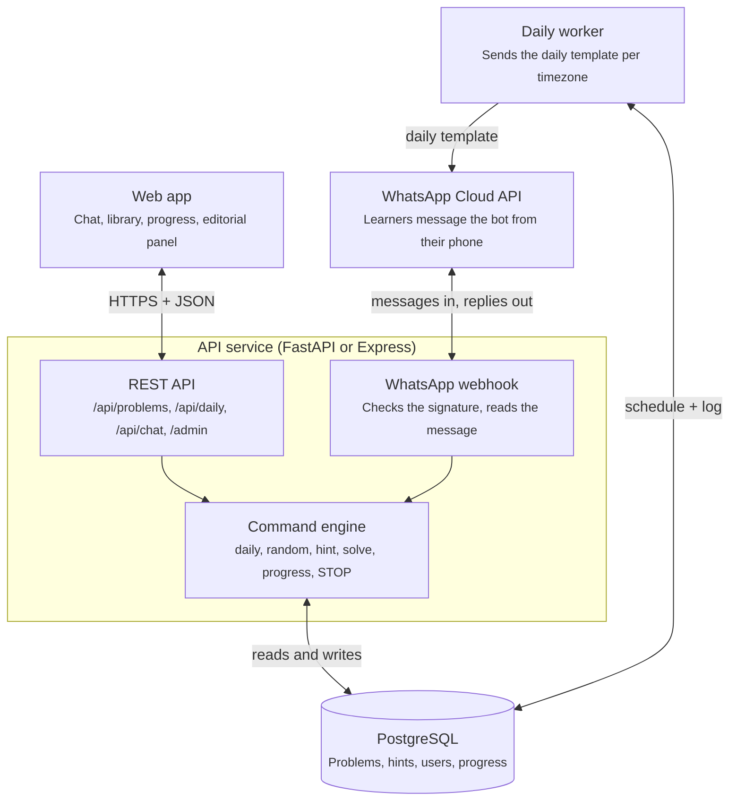

# Backend proposal

_Last updated: 2026-10-19_

Build one API service that owns problems, hints, users and progress, plus a small worker for daily sends. Both the website and WhatsApp talk to the same command engine, so a command behaves the same everywhere.

Both entry points call the same command engine, so `solve 3` answers the same on the site and on WhatsApp. Only the worker starts conversations; everything else is a reply.

## Stack

The README sketches Node.js + Express. If the team is stronger in Python, FastAPI is the better fit; pick one before writing code.

| | FastAPI (Python) | Express (Node.js) |
| --- | --- | --- |
| Validation | Pydantic models built in | Add zod or joi |
| API docs | OpenAPI page generated automatically | Add swagger tooling |
| Database | SQLAlchemy + Alembic migrations | Prisma or Drizzle |
| Scheduler | APScheduler or a cron-run worker | node-cron or BullMQ |
| Shared with frontend | No (separate language) | Yes (same JS as `app.js`) |

Either way: PostgreSQL (Supabase works), secrets in environment variables only, and Docker Compose so anyone can run it with one command.

## Data model

| Table | Key columns | Why it exists |
| --- | --- | --- |
| `users` | `id`, `wa_id` (encrypted), `timezone`, `send_time`, `opted_in_at`, `paused` | Who gets messages, and when |
| `problems` | `id`, `slug`, `title`, `topic`, `difficulty`, `summary`, `source_url`, `video_url`, `status` (draft / reviewed / live) | Replaces `data/problems.js` |
| `hints` | `problem_id`, `level` (1–3), `text` | Real hint ladder: nudge, approach, complexity |
| `daily_schedule` | `date`, `problem_id` | Fixed plan, so adding a problem never reshuffles past days |
| `user_problem_status` | `user_id`, `problem_id`, `status`, `hints_used`, `solved_at`, `confidence` | Progress, streaks, recommendations |
| `deliveries` | `user_id`, `date`, `wa_message_id`, `status` | One row per user per day, so retries never double-send |
| `events` | `user_id`, `type`, `created_at` | Pilot metrics without logging message bodies |

## API

| Method | Path | Purpose |
| --- | --- | --- |
| GET | `/api/problems?topic=&difficulty=&q=` | Library with filters |
| GET | `/api/problems/{id}` | One problem |
| GET | `/api/daily` | Today's problem for the user's timezone |
| GET | `/api/problems/{id}/hints/{level}` | Next hint; records that it was used |
| POST / DELETE | `/api/problems/{id}/solve` | Mark or unmark solved |
| GET | `/api/me/progress` | Solved count, streak, topic coverage |
| PATCH | `/api/me/preferences` | Send time, timezone, pause |
| POST | `/api/chat` | Web chat goes through the same command engine as WhatsApp |
| GET / POST | `/webhooks/whatsapp` | Meta verification and inbound messages (signature checked) |
| POST / PATCH | `/admin/problems` | Editorial panel: add, review, publish |

## WhatsApp rules that shape the design

Since July 1, 2025 Meta bills per delivered template message, by category and the recipient's country ([Meta pricing docs](https://developers.facebook.com/documentation/business-messaging/whatsapp/pricing.md)). Free-form replies are free only inside the 24-hour window that opens when the user messages the bot; after that, only templates can be sent. So the daily push must be an approved template, and every reply to `hint` or `solve` is free because the user just wrote in.

Open question: whether Meta classes a daily practice prompt as a utility or a marketing template, which changes the cost.

## Backend feature ideas

1. **Shared command engine.** One parser returns a reply object; the web renders it as HTML, WhatsApp as text with buttons.
2. **Hint ladder with tracking.** Three levels per problem; hints used feeds recommendations.
3. **Revision queue.** Resurface solved problems after 1, 3, 7 and 14 days, as the README suggests.
4. **Weak-topic recommender.** `random` picks from topics with the fewest solves or the most hints used.
5. **Codeforces auto-verify.** For Codeforces problems, check the learner's handle against the public Codeforces API instead of trusting "solved".
6. **Weekly recap.** One Sunday message: problems solved, topics practiced, the suggested next topic.
7. **Editorial panel.** Teammates add problems, hints and video links with a draft → reviewed → live flow, no code edits.
8. **Privacy commands.** `STOP`, `PAUSE 7`, and `DELETE MY DATA` handled by the bot itself.
